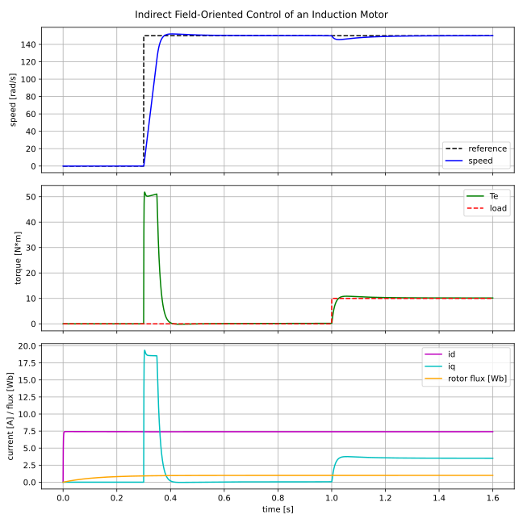

# Vektorregelung — Indirect Field-Oriented Control of an Induction Motor

Eine vollständige, lauffähige Implementierung der **indirekten feldorientierten
Regelung (IFOC)** einer Drehstrom-Asynchronmaschine — als Python-Bibliothek zur
Simulation und als portable C-Bibliothek für den Einsatz auf einem
Mikrocontroller.

A complete, runnable implementation of **indirect field-oriented control
(IFOC)** of a three-phase induction (asynchronous) motor. The control algorithm
is provided twice with identical structure:

* **`python/`** — a dependency-free Python library plus an induction-motor model
  and a closed-loop simulation, for development, analysis and plotting.
* **`c/`** — a portable C99 library (no dynamic allocation, single configurable
  real type) ready to drop into an embedded motor-control project, plus a
  host-side demo and test suite that reproduce the Python results.

Both implementations are cross-checked: the C demo and the Python example
produce the same trajectory for the same motor.



*Magnetisation (0–0.3 s) builds the rotor flux via `id`; a speed step to
150 rad/s accelerates the machine at the current limit; a 10 N·m load step at
1.0 s is rejected by the speed loop.*

---

## What is Vektorregelung?

A three-phase AC machine is awkward to control directly because its currents are
sinusoidal and coupled. Field-oriented control transforms the stator currents
into a reference frame that **rotates with the rotor flux**, where they become
two DC-like quantities:

* **`id`** — the *flux-producing* current (magnetising current),
* **`iq`** — the *torque-producing* current.

In this frame the induction motor behaves like a separately excited DC machine:
hold the flux constant with `id`, and command torque directly with `iq`. The
"indirect" method computes the flux angle from the **slip relation** and the
measured shaft speed (a current-model flux estimator), so **no flux sensor** is
required.

### Control structure

```
                 ┌──────────────┐  iq*   ┌──────────────┐ vq  ┌─────────┐
   ω*  ──►(–)──► │  speed PI    ├──────► │  q-current PI├───► │         │
          ▲      └──────────────┘        └──────────────┘     │ decouple│ vα,vβ ┌──────┐
          │ ω                      id*=ψ*/Lm ┌────────────┐vd │  + inv. ├──────►│SVPWM ├─► duties
          │            ┌─────────►(–)──────► │ d-current PI├──►│  Park   │       └──────┘
          │            │ id                  └────────────┘   └─────────┘
          │            │                                          ▲ θe
       measured     ┌──┴───────── Park ◄── Clarke ◄── ia,ib,ic    │
        speed       │   id,iq                                     │
                    └─► flux estimator ─► slip ─► θe = ∫(p·ω + ωslip)dt
```

Per control step (`vr_foc_update` / `IndirectFOC.update`):

1. **Clarke + Park** the measured phase currents into the rotor-flux frame using
   the estimated field angle `θe`.
2. **Rotor-flux estimator** (current model): `dψ/dt = (Lm·id − ψ) / Tr`.
3. **Slip** `ωslip = Lm·iq / (Tr·ψ)`, field angle `θe = ∫(p·ω + ωslip) dt`.
4. **Speed PI** loop → torque-current reference `iq*` (current-limited).
5. **Current PI** loops (d and q) → stator voltage command.
6. **Decoupling feed-forward** of the cross-coupling and back-EMF terms.
7. **Voltage limiting**, **inverse Park**, **space-vector PWM** → duty cycles.

The PI gains are tuned automatically from the motor parameters: the current
loops by internal-model control on the stator transient circuit, the speed loop
with its zero placed a decade below crossover for a robust phase margin.

---

## Repository layout

```
vektorregelung/
├── README.md
├── docs/
│   └── foc_simulation.svg          generated result plot
├── python/
│   ├── pyproject.toml
│   ├── src/vektorregelung/
│   │   ├── transforms.py           Clarke/Park transforms
│   │   ├── pi_controller.py        PI controller + anti-windup
│   │   ├── svpwm.py                space-vector PWM
│   │   ├── induction_motor.py      motor model (RK4)
│   │   ├── foc.py                  indirect FOC controller
│   │   └── simulation.py           closed-loop harness
│   ├── examples/run_simulation.py  runnable demo (+ plot)
│   └── tests/                      pytest suite
└── c/
    ├── Makefile
    ├── include/vektorregelung/*.h  public headers
    ├── src/*.c                     library sources
    ├── examples/sim_demo.c         host demo (CSV output)
    └── tests/test_vektorregelung.c self-contained test suite
```

The two libraries share the same module breakdown and naming so the C code reads
as a direct translation of the Python.

---

## Python

No runtime dependencies for the library itself; `matplotlib` is optional and
only used for the example plot.

```bash
cd python

# Run the closed-loop demo (prints a summary, writes examples/foc_simulation.png)
PYTHONPATH=src python3 examples/run_simulation.py

# Run the test suite
python3 -m pytest            # uses pyproject.toml (pythonpath = src)
```

Minimal usage:

```python
from vektorregelung import (
    IndirectFOC, InductionMotor, InductionMotorParameters, simulate,
)

motor = InductionMotorParameters(
    rs=1.5, rr=1.2, ls=0.14, lr=0.14, lm=0.135,
    pole_pairs=2, inertia=0.02, friction=0.001,
)

controller = IndirectFOC.from_motor(
    motor, dt=1e-4, v_dc=600.0, rotor_flux_ref=1.0, i_max=20.0,
)

# One real-time control step (currents and shaft speed come from your sensors):
out = controller.update(speed_ref=150.0, ia=ia, ib=ib, ic=ic, omega_m=omega)
duty_a, duty_b, duty_c = out.duty_a, out.duty_b, out.duty_c
```

---

## C

Portable C99, no dynamic allocation, depends only on `libm`. The library is
built around a single real type `vr_float`, which defaults to `float` (matching
a typical embedded single-precision FPU); define `VR_REAL_DOUBLE` for double
precision.

```bash
cd c

make            # build static library  build/libvektorregelung.a
make demo       # build + run the closed-loop demo (matches the Python output)
make test       # build + run the self-contained test suite
```

The demo and tests are compiled with `-DVR_REAL_DOUBLE` so their numbers match
the Python reference exactly.

Minimal embedded usage (the control step contains no allocations and no I/O):

```c
#include "vektorregelung/foc.h"

static vr_foc_t foc;

void drive_init(void)
{
    vr_motor_params_t m = {
        .rs = 1.5f, .rr = 1.2f, .ls = 0.14f, .lr = 0.14f, .lm = 0.135f,
        .pole_pairs = 2, .inertia = 0.02f, .friction = 0.001f,
    };
    /* dt, v_dc, rotor flux ref, i_max, (0 = default current/speed bandwidth) */
    vr_foc_init_tuned(&foc, &m, 1.0e-4f, 600.0f, 1.0f, 20.0f, 0.0f, 0.0f);
}

/* Call from the PWM/ADC interrupt at the control rate (here 10 kHz). */
void control_isr(float ia, float ib, float ic, float omega_m, float speed_ref)
{
    vr_foc_output_t out =
        vr_foc_update(&foc, speed_ref, ia, ib, ic, omega_m);
    pwm_set_duty(out.duty.a, out.duty.b, out.duty.c);
}
```

### Porting to a microcontroller

* Compile `c/src/*.c` and add `c/include` to the include path; leave
  `VR_REAL_DOUBLE` undefined to use `float`.
* `vr_foc_update()` does no allocation, no I/O and runs in bounded time — call it
  from your current-loop interrupt.
* Replace the simulation model (`induction_motor.c`) with your real plant: feed
  measured phase currents and shaft speed in, send `out.duty.{a,b,c}` to the PWM.
* `vr_max_voltage()` and the built-in current/voltage limiting keep the
  modulation inside the linear SVPWM region.

---

## Model & parameters

The example uses a ~3 kW / 4-pole / 400 V squirrel-cage induction machine:

| Symbol | Meaning | Value |
| ------ | ------- | ----- |
| `Rs` | stator resistance | 1.5 Ω |
| `Rr` | rotor resistance (referred) | 1.2 Ω |
| `Ls`,`Lr` | stator/rotor inductance | 0.14 H |
| `Lm` | mutual inductance | 0.135 H |
| `p` | pole pairs | 2 |
| `J` | inertia | 0.02 kg·m² |
| `B` | viscous friction | 0.001 N·m·s |
| `Vdc` | DC-link voltage | 600 V |
| `ψr*` | rated rotor flux | 1.0 Wb |
| `Imax` | current limit | 20 A |

The induction-motor model is integrated with a fixed-step **RK4** scheme in the
stationary (α/β) reference frame; the controller only ever sees the stator phase
currents and the measured shaft speed, exactly as on real hardware.

---

## License

MIT — see `LICENSE`.
